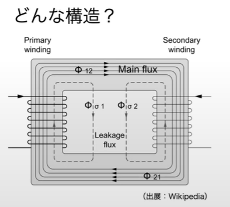
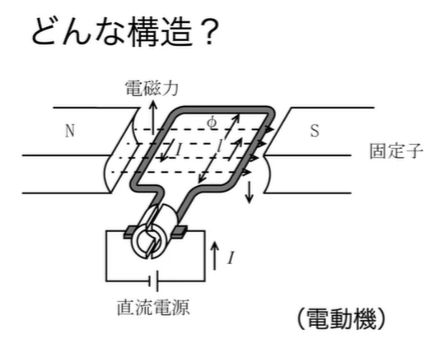
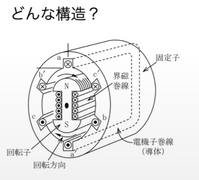
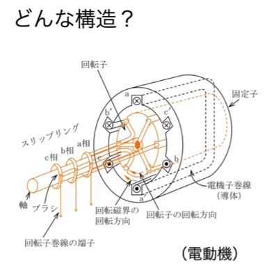
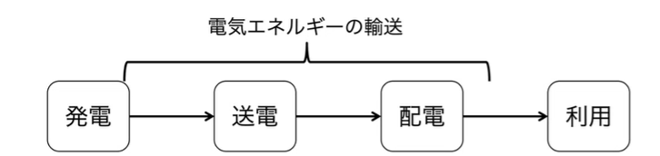

## 第1回 イントロダクション

*デジタル社会の発展＝電力需要の増大*

### <u>1．本講義で取り上げる電気機器</u>
- 変圧器
- 直流機
- 同期機
- 誘導機

*これらは発電，送電，電力利用に用いられる．*

---

#### ・変圧器
「電圧/電流変換」，「電力変換」を行う．電力輸送，電力変換，通信，計測器に使われる

- 大～小容量
- 大～小型

#### ・直流機
「直流発電機」，「直流電動機」，精密モーターに使われる．

- 高い速度制御性
- 小型(数mW)から大型(>10,000kW)

#### ・同期機
「交流発電機」，「交流電動機」，電力発電機，精密モーターに使われる．

- 大容量発電
- 負荷・力率調整用モーター
- 精密速度制御

#### ・誘導機
「交流発電機」，「交流電動機」，大容量モーター．家庭用機器モーターに使われる．

- 構造が簡単，小型
- 安価，保守が容易

---
#### ・まとめ？
各段階の変電所で段階的に電圧調整してるよ．(電柱には柱上変圧器って変圧器付いてるよ)

電気エネルギーの発生・輸送・利用

---
### <u>2．電気エネルギーの概要</u>

*人口増えてるよ→エネルギーも増えてるよ(**コロナ**とか**オイルショック**とかでは減ったよ)*

---

#### ・エネルギーの種類
**一次エネルギー**(自然界に存在するエネルギー源：原油，石炭，天然ガス等)や**再生可能エネルギー**

↓

**二次エネルギー**(一次エネルギーを変換したもの：ガソリン，重油，灯油，都市ガス，電気エネルギー等)

---

#### ・発電方式
- 火力(石炭，石油，天然ガス)
- 水力(ダム)，揚水
- 原子力
- 再生可能エネルギー(太陽光，風力，地熱，潮流)

---

最後に各国の発電方法の割合とか，一人あたりの電力使用量の推移とか，日本全体の電気使用量とか話してた．
