## 第2回 変圧器
基本構造(コイル2個のアレ)

### <u>1．基礎</u>

#### ・変圧器
色々書いてた．変電設備も色々あるって．

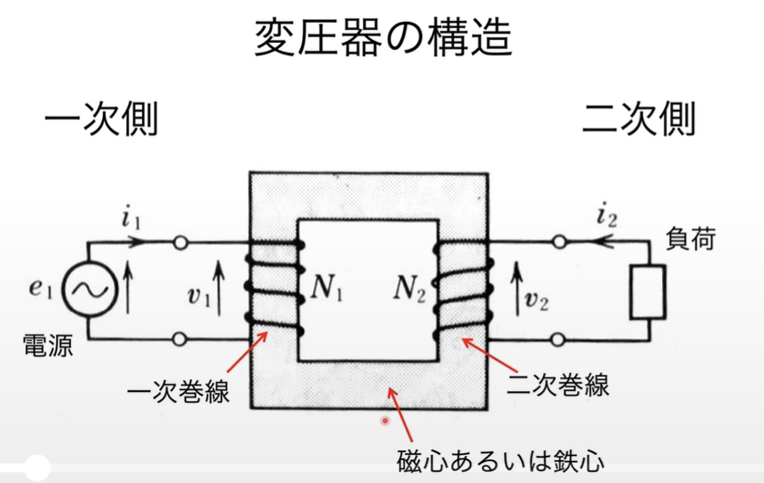

#### ・電流の磁気作用
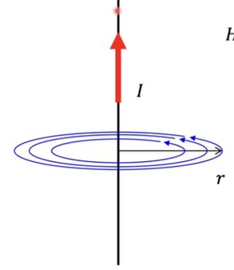

アンペールの法則から，磁界の強さ $H$ は

$$
H=\frac{I}{2\pi r}　\mathrm{[A/m]}
$$

磁束密度 $B$ は

$$
B=\mu H　\mathrm{[T]}
$$

で表される．ただし $\mu$ は透磁率 $\mathrm{[H/m]}$

#### ・磁気回路

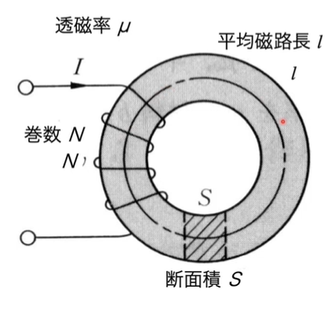

$$H=\frac{NI}{l}$$

$$B=\mu H=\frac{\mu NI}{l}$$

磁束 $\phi$ は

$$
\phi=SB=\frac{\mu NIS}{l}=\frac{NI}{R}　
\mathrm{[Wb]}
$$

磁束鎖交数 $\psi$ は

$$\psi=N\phi$$

起磁力 $F$ は

$$F=NI　\mathrm{[A]}$$

磁気抵抗 $R$ は

$$R=\frac{l}{\mu S}　\mathrm{[\Omega]}$$

#### ・電磁誘導
誘導起電力 $e$ は

$$
e=-N\frac{d\phi}{dt}　\mathrm{[V]}
$$

1秒間に1Wbの磁束が変化すると，コイル1巻きあたり1Vの起電力が誘導される．

---

### <u>2．変圧器の原理</u>

#### ・多巻式リアクトル
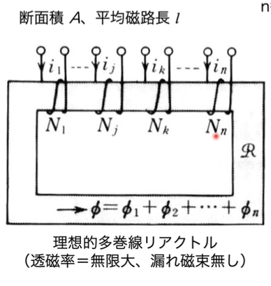

n番目の巻き線の磁束鎖交数 $\psi_n$ は

$$
\begin{aligned}
\psi_n&=N_n\phi\\
&=N_n(\phi_1+\phi_2+\dots+\phi_n)\\
&= N_n\left(
\frac{N_1}{R}i_1
+\frac{N_2}{R}i_2
+\cdots
+\frac{N_n}{R}i_n
\right) \\[6pt]
&= \frac{N_nN_1}{R}i_1
+\frac{N_nN_2}{R}i_2
+\cdots
+\frac{N_nN_n}{R}i_n \\[6pt]
&= M_{n1}i_1
+M_{n2}i_2
+\cdots
+L_{nn}i_n
\end{aligned}
$$

$$
・M_{1n}=N_nN_1/R\text{　相互インダクタンス}
$$
$$
・L_{nm}=N_n^2/R\text{　自己インダクタンス}
$$

---

**
等アンペアターンの法則
**

理想的なリアクトルでは，

$$
\mu = \infty, 
R = \frac{l}{\mu S} = 0, 
\psi_n = N_n\left(\frac{N_1i_1+N_2i_2+\dots+N_ni_n}{R}\right)
$$

より，

$$
(N_1i_1+N_2i_2+\dots N_ni_n)=0
$$

---

#### ・二巻線の変圧器

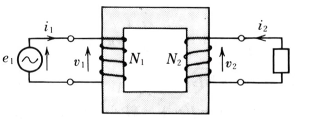

等アンペアターンの法則より，

$$
N_1i_1+N_2i_2 = 0
$$

$$
\therefore\frac{i_1}{i_2} = -\frac{N_2}{N_1} = -\frac{1}{a}\\
(\text{巻線比　}a = \frac{N_1}{N_2})
$$

各巻線の誘導起電力

$$
v_1 = \frac{d\psi_1}{dt} = N_1\frac{d\phi}{dt},
v_2 = \frac{d\psi_2}{dt} = N_2\frac{d\phi}{dt}
$$

$$
\therefore\frac{v_1}{v_2} = \frac{N_1}{N_2}=a
$$

我流

$$
v_1 = \frac{N_1}{N_2}v_2\\
v_1\times N_2 = v_2\times N_1
$$

---

### <u>3．変圧器の等価回路</u>

#### ・変圧器の極性

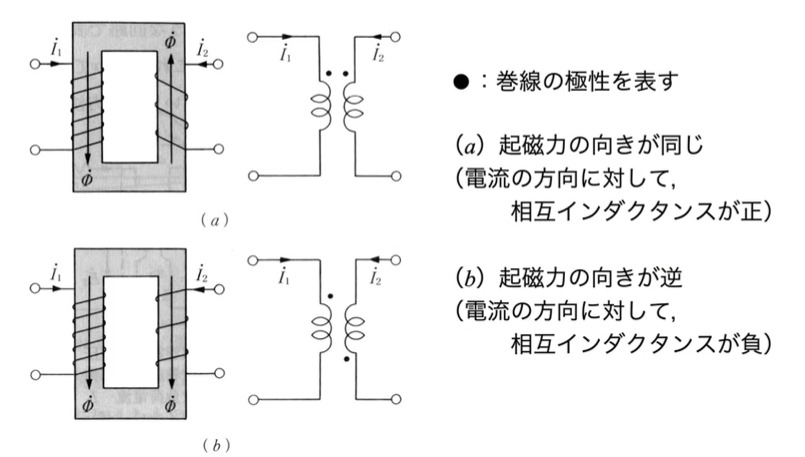

#### ・一般的等価回路

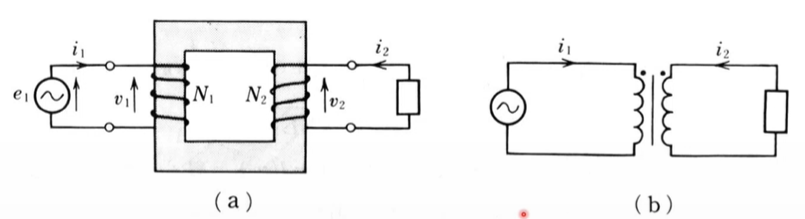

各巻線の誘導起電力は

$$
\begin{aligned}
\left[
    \begin{matrix}
    v_1\\
    v_2
    \end{matrix}
\right]

&=[R][i]+\frac{d}{dt}
\left[
    \begin{matrix}
    \psi_1\\
    \psi_2
    \end{matrix}
\right]\\

&=
\left[
    \begin{matrix}
    R_1 & 0\\
    0 & R_2
    \end{matrix}
\right]
\left[
    \begin{matrix}
    i_1\\
    i_2
    \end{matrix}
\right]

+\frac{d}{dt}
\left[
    \begin{matrix}
    L_{11} & M_{12}\\
    M_{21} & L_{22}
    \end{matrix}
\right]
\left[
    \begin{matrix}
    i_1\\
    i_2
    \end{matrix}
\right]
\end{aligned}
$$

$$
([R][i]\text{は巻線抵抗による電圧降下})
$$

またここで，

$$
\begin{aligned}
\psi_1 &=N_1\phi = N_1
\left(
    \frac{N_2i_2}{R}+
    \frac{N_1i_1}{R}
\right)\\

&=\frac{N_1N_2}{R}i_1+
\frac{N_1^2}{R}i_1
=M_{12}i_2+L_{11}i_1，
\end{aligned}
$$

より

$$
M_{12} = M_{21} = \frac{N_1N_2}{R}，
L_{11} = \frac{N_1^2}{R}
$$

#### ・漏れ磁束を考慮した変圧器モデル

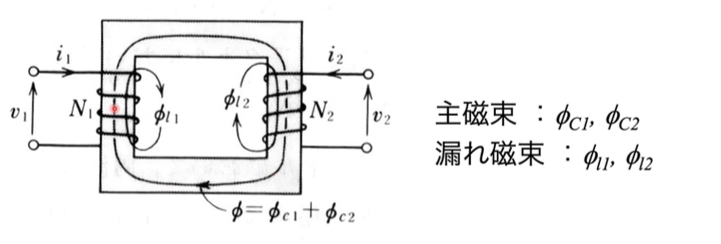

$$
\psi_1 = N_1\phi_1 = N_1(\phi_{l1} + \phi_{C1} + \phi_{C2})\\
\psi_2 = N_2\phi_2 = N_2(\phi_{l2} + \phi_{C1} + \phi_{C2})\\
$$

$$
\phi_{l1} = \frac{N_1i_1}{R_{l1}},　
\phi_{l2} = \frac{N_2i_2}{R_{l2}},　
\phi_{C1} = \frac{N_1i_1}{R_{c}},　
\phi_{C2} = \frac{N_2i_2}{R_{c}}\\

R_{l1}, R_{l2}:\text{漏れ磁束に対する磁気抵抗}\\
R_c:\text{主磁束に対する磁気抵抗}
$$

#### ・等価回路のパラメータ
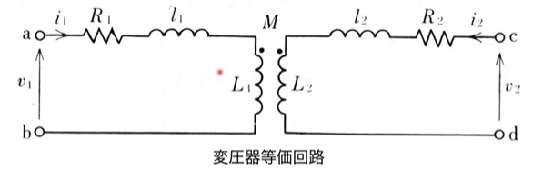

$$
\begin{aligned}
\begin{bmatrix}
  v_1\\
  v_2
\end{bmatrix}

&= [R]
\begin{bmatrix}
  i_1\\
  i_2
\end{bmatrix}

+ \frac{d}{dt}
\begin{bmatrix}
  \psi_1\\
  \psi_2
\end{bmatrix}\\

&= \begin{bmatrix}
  R_1 & 0\\
  0 & R_2
\end{bmatrix}
\begin{bmatrix}
  i_1\\
  i_2
\end{bmatrix}

+ \frac{d}{dt}
\begin{bmatrix}
  L_{11} & M_{12}\\
  M_{21} & L_{22}
\end{bmatrix}
\begin{bmatrix}
  i_1\\
  i_2
\end{bmatrix}
\end{aligned}
$$

上のような形で表される．ここで，

$$
\begin{align}
\psi_1 = N_1\phi_1
= N_1(\phi_{11}+\phi_{c1}+\phi_{c2})\\
\psi_2 = N_2\phi_2
= N_2(\phi_{12}+\phi_{c1}+\phi_{c2})\\

\phi_{11} = \frac{N_1 i_1}{R_{l1}},
\phi_{12} = \frac{N_2 i_2}{R_{l2}},
\phi_{c1} = \frac{N_1 i_1}{R_c},
\phi_{c2} = \frac{N_2 i_2}{R_c}
\end{align}
$$

この~~6つ~~3つの式より，パラメータ $L_{11},L_{22},M_{12},M_{21}$ が求められる．

$$
\begin{aligned}
L_{11} &= l_1+L_1,
&
l_1 &= \frac{N_1^2}{R_{l1}},
&
L_1 &= \frac{N_1^2}{R_c},
&
M_{12} &= \frac{N_1N_2}{R_c}

\\[6pt]

L_{22} &= l_2+L_2,
&
l_2 &= \frac{N_2^2}{R_{l2}},
&
L_2 &= \frac{N_2^2}{R_c},
&
M_{21} &= \frac{N_1N_2}{R_c}
\end{aligned}

\\[6pt]

l_1,l_2:\text{漏れインダクタンス}\\
L_1,L_2:\text{主インダクタンス}\\
M_{12} = M_{21} = M
$$

---

#### ・結合係数
結合係数 $k$ ：巻線間の結合の度合いを表す

$$
k = \frac{M}{\sqrt{L_{11}\cdot L_{22}}} 
= \sqrt{\frac{L_1}{l_1+L_1}}\sqrt{\frac{L_2}{l_2+L_2}}
\\[6pt]
k\text{:各巻線の自己インダクタンス中に占める主インダクタンスの割合の幾何平均}\\
\text{(磁束の漏れの程度)}
$$

---

#### ・一次側/二次側換算
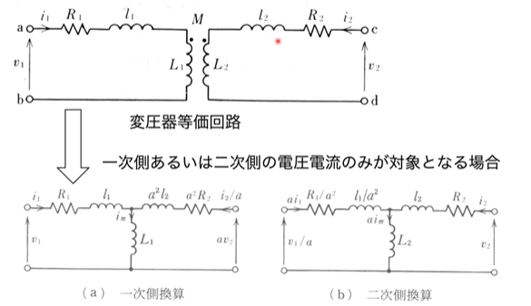

回路が分かれていると計算しづらいらしい．~~ややこしくしやがって…余計なことを…~~

- <u>一次側換算の方法</u>

$$
\begin{bmatrix}
  v_1\\
  v_2
\end{bmatrix}

= \begin{bmatrix}
  R_1 & 0\\
  0 & R_2
\end{bmatrix}
\begin{bmatrix}
  i_1\\
  i_2
\end{bmatrix}

+ \frac{d}{dt}
\begin{bmatrix}
  L_{11} & M_{12}\\
  M_{21} & L_{22}
\end{bmatrix}
\begin{bmatrix}
  i_1\\
  i_2
\end{bmatrix}
$$

$v_1$ はそのまま， $v_2$ は両辺に巻線比 $a=N_1/N_2$ を乗じる

$$
a\cdot M  = \frac{N_1}{N_2}\cdot\frac{N_1N_2}{R_c}
= \frac{N_1^2}{R_c}
= L_1
\\[6pt]
a\cdot L_2 = \frac{N_1}{N_2}\frac{N_2^2}{R_c}
= \frac{N_1N_2}{R_c}
= M
= \frac{L_1}{a}
$$

より，

$$
v_1 = R_1i_1
+ l_1\frac{di_1}{dt}
+ L_1\frac{d}{dt}\left(i_1 + \frac{i_2}{a}\right)
\\[6pt]
av_2 = a^2R_2\left(\frac{i_2}{a}\right)
+ a^2l_2\frac{d}{dt}\left(\frac{i_2}{a}\right)
+ L_1\frac{d}{dt}\left(i_1 + \frac{i_2}{a}\right)
$$

※一度計算しておくのおすすめ．この式が表す等価回路が写真の (a)一次側換算 の回路．電圧のキルヒホッフを2回すると確認できる．

---

#### ・インピーダンス整合

変圧器を通して見た二次側インピーダンスは $a^2$ 倍になる(一次側/二次側変換の写真の回路 参照)

→**インピーダンス整合**の為に変圧器が利用される．

入力側の出力インピーダンスと出力側のインピーダンスを合わせる

→出力側で受ける電力が最大になる．

#### ・電力変圧器の等価回路(大電力の場合)
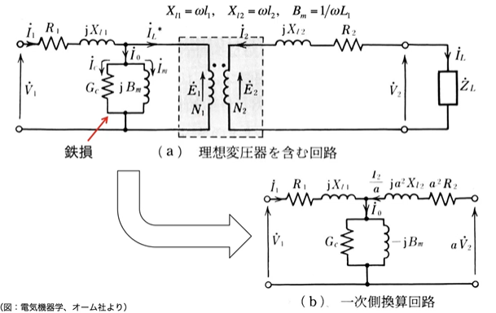

大電力の場合は**鉄損**(磁気的な損失)を考える必要がある．

#### ・簡易等価回路
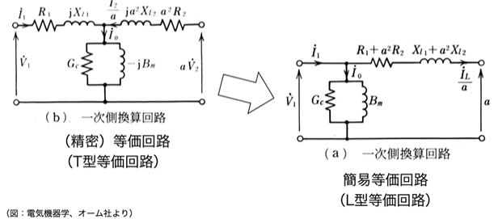

変圧器の特性において，励磁電流成分 $I_0$ による $R_1+jX_{l1}$ における電圧降下が無視できる場合，励磁アドミタンス $Y_0$ を電源側に移して計算を簡単にする．

---

### <u>4．各種変圧器の構造</u>

#### ・単相変圧器の構造
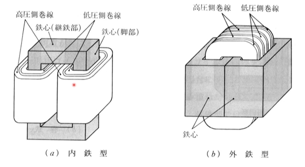

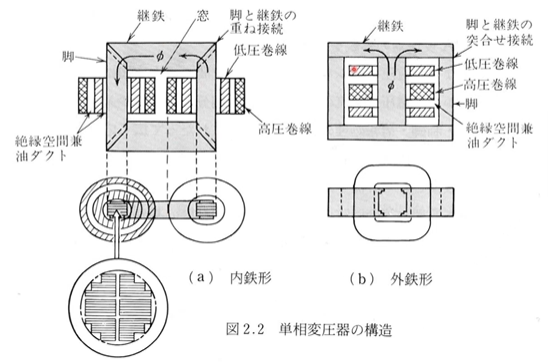

よく使われる単相変圧器は**内鉄型**と**外鉄側**の2種類に分かれる．

#### ・三相変圧器の構造
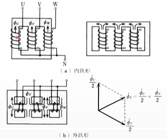

三相変圧器の長所：
- 使用鉄量が少ないため，鉄損が小さく効率がいい
- 重量，価格が低く，専有床面積も小さい
- ブッシングなどの引き出し口数を減らせる

あとは変電所，高圧変圧器の写真とか，冷却方式の話してた．