## 第3回 変圧器(続き)，直流機
最初に復習してた．

---

### <u>5．変圧器鉄心の特性</u>

#### ・強磁性材料の磁化特性
変圧器用の強磁性体
- 低周波数領域：ケイ素鋼（Fe,Si 1.5～3%）
- 高周波数領域：フェライト（Fe2O3を主とする磁性酸化物）

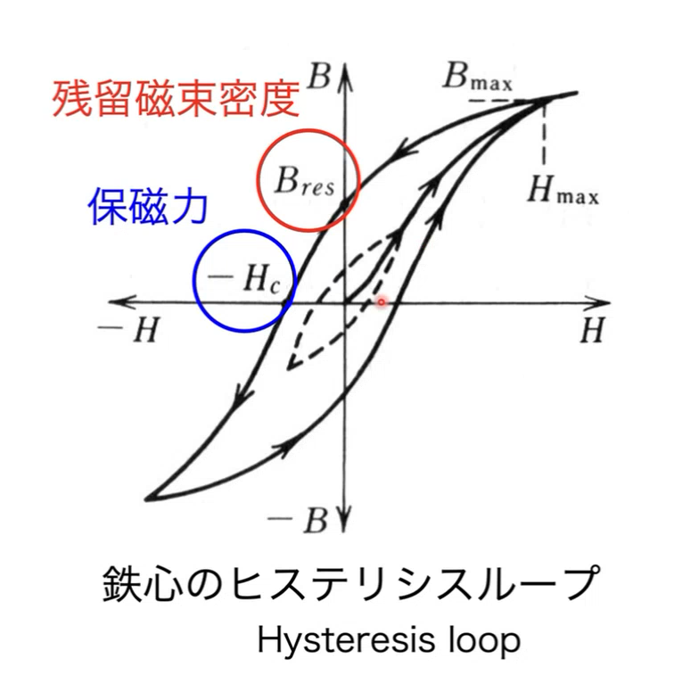

---

#### ・磁束の変化による損失
変圧器の鉄心中の磁束の変化による損失＝**鉄損**（下の2種類）
- ヒステリシス損
- うず電流損

※ちなみに銅損はジュール損失というらしい

#### ・ヒステリシス損

励磁：$-B_{max}→B_{max}→-B_{max}$

グラフの矢印(写真参照)に従うため，ヒステリシスループの面積に相当するエネルギーが消費される．これがヒステリシス損．

交流を考えているので，一周期で1ループ分の損失．

$$
\text{ヒステリシス損　}P_H = \text{(ヒステリシスループの面積)}\times f　\mathrm{[W/m^3]}
\\
f:\text{励磁電源周波数}
$$

$$
\text{近似式　}P_H = k_H B_{max}^n \cdot f
\\
k_H:\text{ヒステリシス定数}，n:\text{Steinmetz定数（約1.6）}
$$

#### ・うず電流損
磁束の変化→うず電流

$$
P_e = \delta_ef^2B_{max}^2　\mathrm{[W/m^3]}
\\
\delta_e:\text{磁性材料によって決まる定数}
$$

成層構造の場合

$$
P_e = \frac{K_ef^2d^2B_{max}^2}{\rho}　\mathrm{[W/m^3]}
\\[6pt]
K_e : \pi^2/6\\
\rho : \text{成層鋼板の抵抗率}\\
d : \text{成層鋼板の厚み}
$$

$d$について，
- 商用周波数用：0.4mm前後
- 高周波数用：0.1mmの方向性けい素鋼板

---

#### ・損失と効率
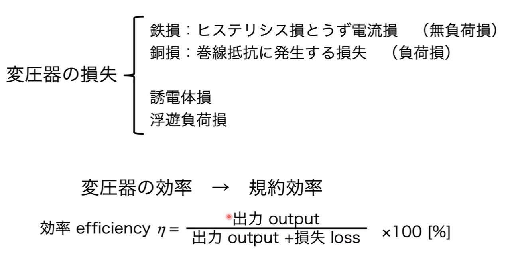

---

#### ・励磁回路の等価回路
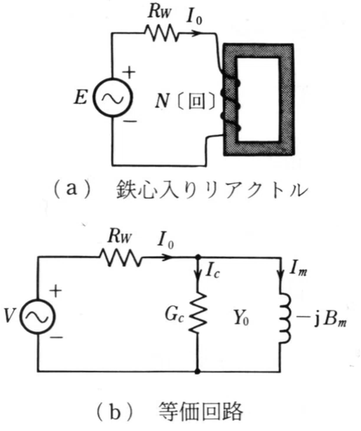

$R_W$：巻線抵抗（巻線の抵抗損（銅損）） 
$G_c$：鉄損を表すコンダクタンス分  
$B_m$：巻線がもつサセプタンス分  
$I_m$：磁化電流  
$I_c$：鉄損電流  
$Y_0$：励磁アドミタンス（$G_c-jB_m$）

※鉄損をヒステリシス損とうず電流損に分離することは難しい．

---

### <u>6．変圧器の結線</u>

#### ・単相変圧器の三相結線
ガチ雑な説明で終わった(オワタ…じゃなくて，説明が一瞬で終わった)．これ見るような人は覚えなくて良い．  
見たい人は授業動画の第3回，28:50~から

---

### <u>7．いろいろな変圧器</u>

ほえ～で終わり．

透磁率が小さく，鉄損の少ない材料を鉄心に用いて，漏れ磁束，励磁電流，巻線抵抗を小さくする．

---

ここから**直流機**の内容に入る

### <u>1．基礎</u>

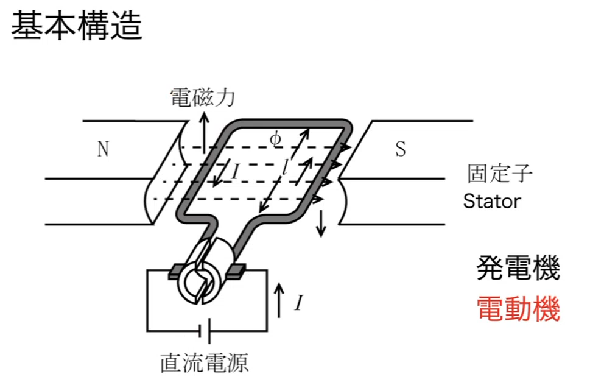  
*同じ構造でどちらでも使える．発電機/電動機(モーター)*

直流機：最も古い電気機械（Pixiiの磁石発電機）．精密モーターとして色んなとこで使われてる．

---

#### ・電磁誘導
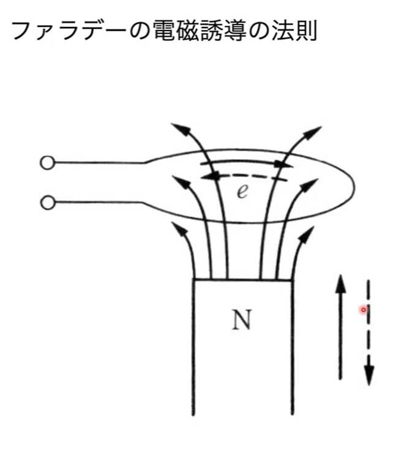

$$
誘導起電力e = -N\frac{d\phi}{dt}　\mathrm{[V]}
$$

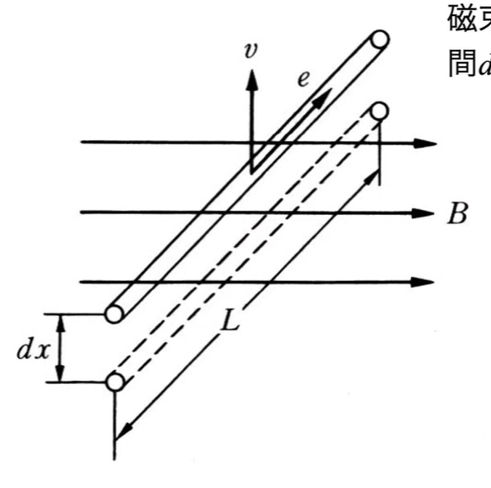

磁束密度$B\mathrm{[T]}$の磁界中を長さ$L\mathrm{[m]}$の導体が時間$dt$の間に$dx$だけ動いたときの磁束の変化$d\phi$

$$
d\phi = BLdx
\\
\therefore
\frac{d\phi}{dt} = e = BL\frac{dx}{dt}
\\
\therefore
e = vBL
$$

---

#### ・発電機動作

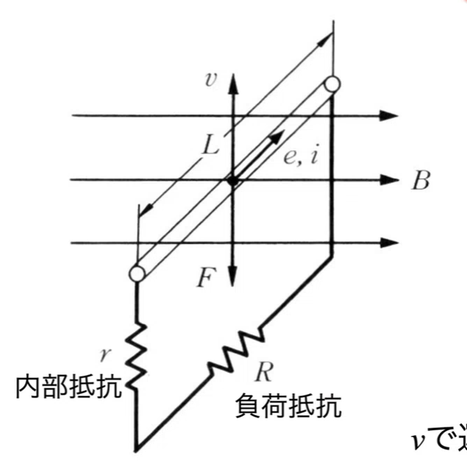

$$
誘導起電力e = vBL
\\
回路に流れる電流i = \frac{e}{R+r}
\\
電磁力F = iBL
$$

$v$と逆向きに$F$が生じる．$v$で運動し続けるには$F$と同じ大きさで反対向きの$F'$を加える必要がある．導体に加えられる単位時間あたりの機械的エネルギー$P$は

$$
\begin{aligned}
P &= F'v
=iBL\frac{e}{BL}
=ie\\
&=i^2R+i^2r
\end{aligned}
$$

ここで，$i^2R$は負荷抵抗に供給される電力(取り出せる電力)，$i^2r$はジュール損である．

---

#### ・電動機動作
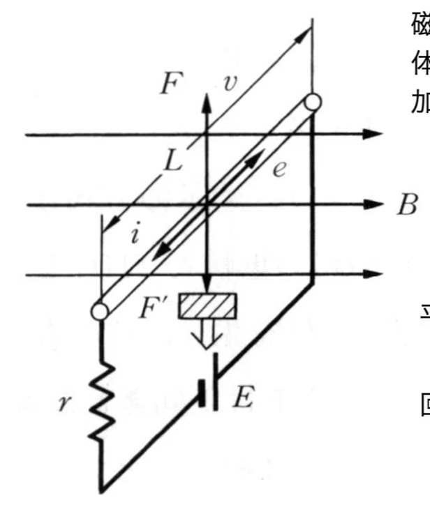

磁束密度$B$の磁界中に置かれた長さ$L$の導体の両端に起電力$E$を供給して，外力$F'$を加えた時の動作

平衡状態では$F=F'=iBL$  
回路に対して$E=e+ir=vBL+ir$  
(導体が磁場内を動くので誘導起電力$e$が発生)

電源から供給される電力$P$について

$$
\begin{aligned}
P &= Ei = (vBL + ir)i
\\
&= vBLi + i^2r
\\
&= F'v + i^2r　(\because F' = iBL)
\end{aligned}
$$

電源から供給された電気エネルギー＝機械エネルギー$F'v$＋ジュール損

---

#### ・直流発電機の原理
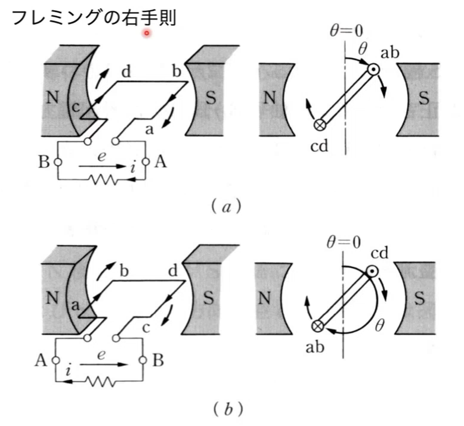

これだと交流．下の写真のように整流する．

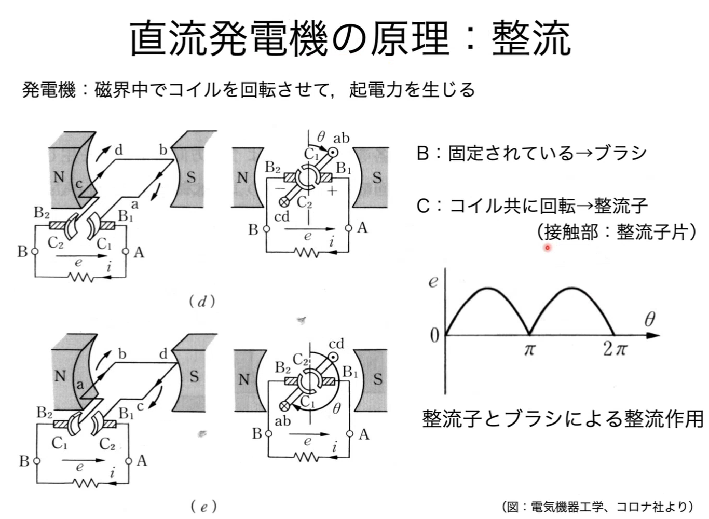

---

#### ・直流電動機の原理
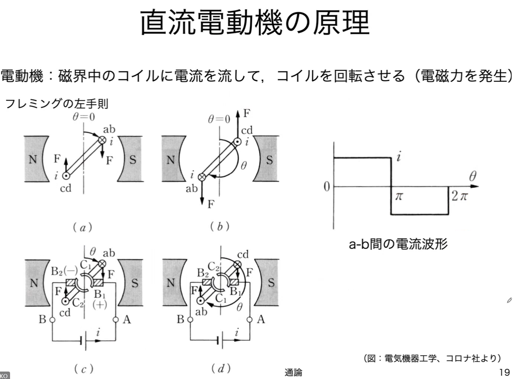

半回転ごとにブラシと端子がくっついたり離れたり→常に同じ方向に回転する

#### ・直流機の基本構成
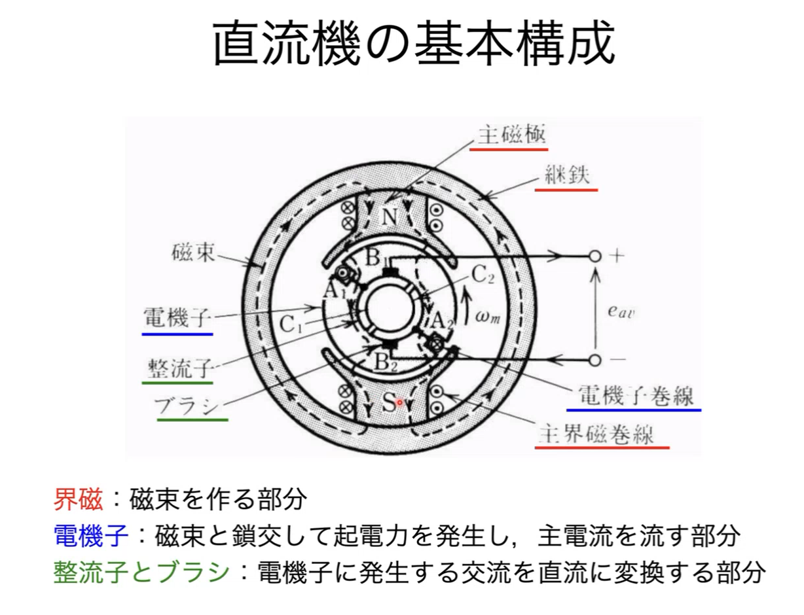

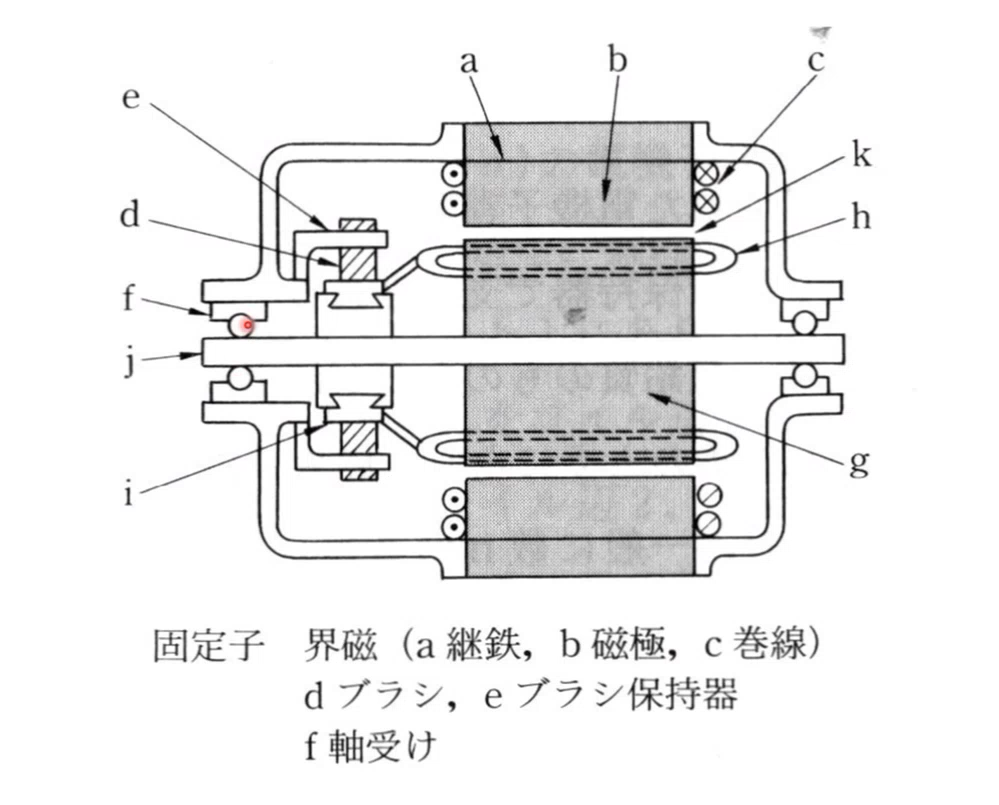

---

こんなのもある
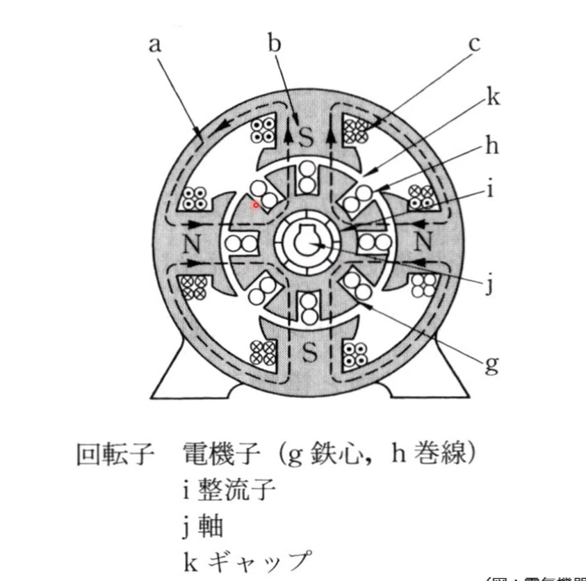