## 第4回 直流機(続き)

### <u>2．励磁方式</u>

#### ・励磁方式による直流機の分類

励磁：コイルに電流を流して磁束を発生させること．界磁巻線に電流を流して励磁する．

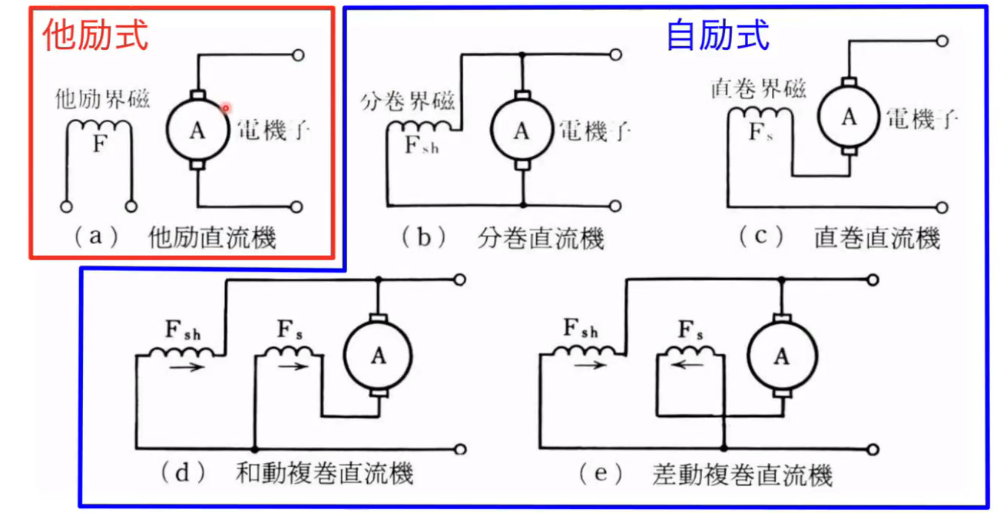

- 他励直流機：電機子巻線とは別の直流電源によって励磁される他励巻線を界磁巻線とする．広範囲に精密な速度制御を行う大型，中型の電動機に用いられる．(分巻直流機が一般的)

- 直巻直流機：電機子巻線と直列に接続される直巻巻線を界磁巻線とする．始動トルクが大きいので，電車用電動機や自動車のスターターモーターに用いられる．

---

### <u>3．電機子巻線</u>
電機子：磁束と鎖交して起電力を発生し，主電流を流す部分．  
「・直流電動機の原理」における発電機やモーターで回ってた部分．

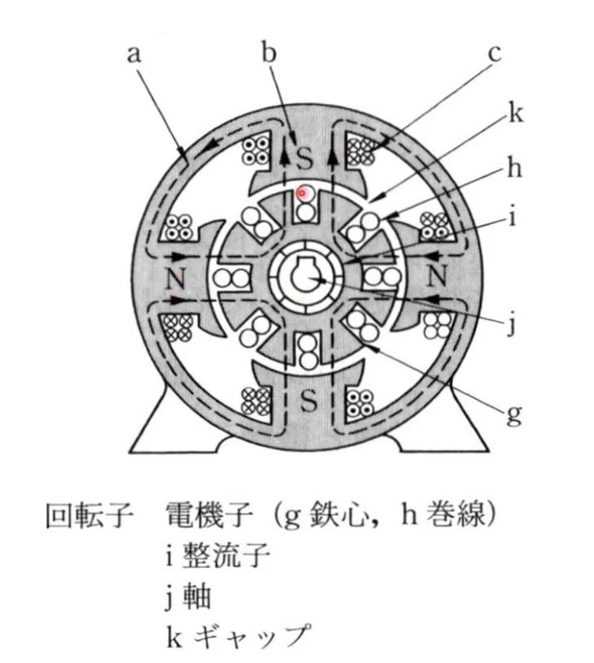

↓上の写真のgの溝を上から見た図

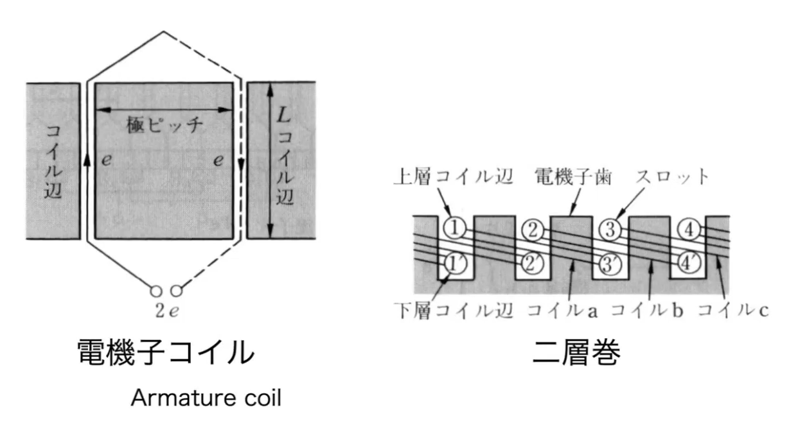

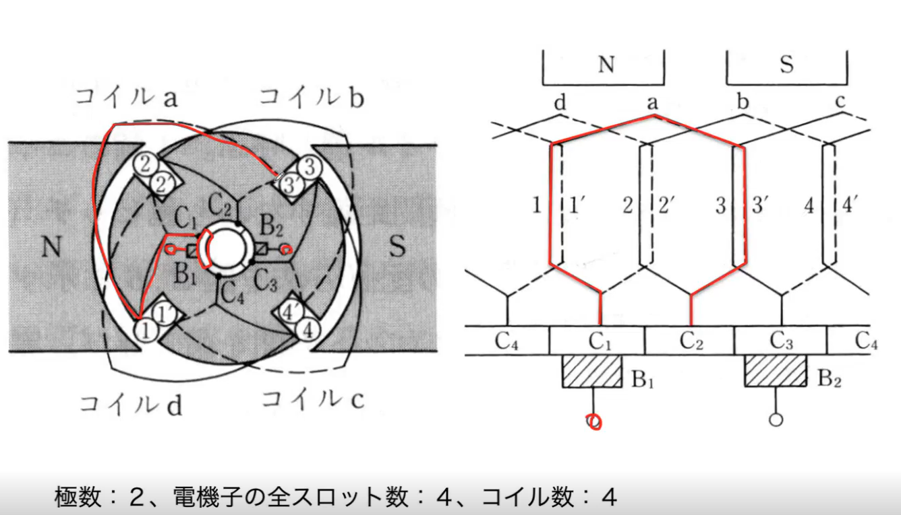

1 => 3' = C2 => 2 => 4' = C3 => 3 => 1' = C4 => 4 => 2' = C1 =>1  
という巻き方．変なの．

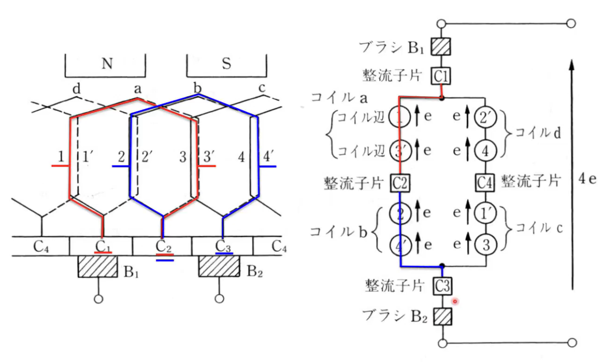

一つあたりのコイルの誘導起電力の4倍の端子間電圧になる

#### ・電機子巻線の巻き方

重ね巻(並列多)
- 極数とコイル並列回路数が同じ．
- 低電圧，大電流
- 大型，中型機

並巻(直列多)
- 極数に関係なくコイル並列回路数は2
- 高電圧，小電流(300mA以下)
- 中型，小型機

並列回路数が多い  
→直列回路数(一本あたりの端子の数？)が減る  
→端子間電圧が小さくなる

直列回路数が多い  
→並列回路数が減る  
→大電流に耐えられなくなる

↓重ね巻（極数が4の場合）とその回路図
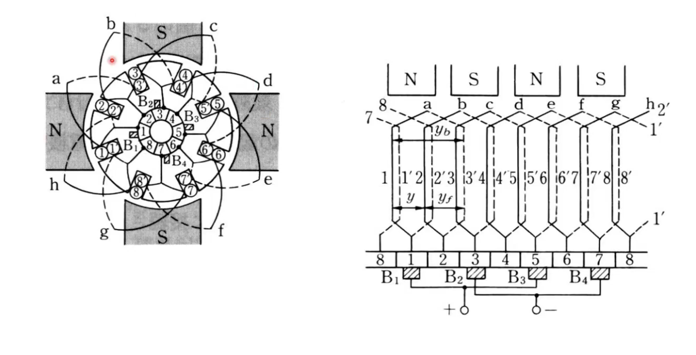

教授「ゴチャゴチャしてるので，あんまり見てもしょうがない」←言った

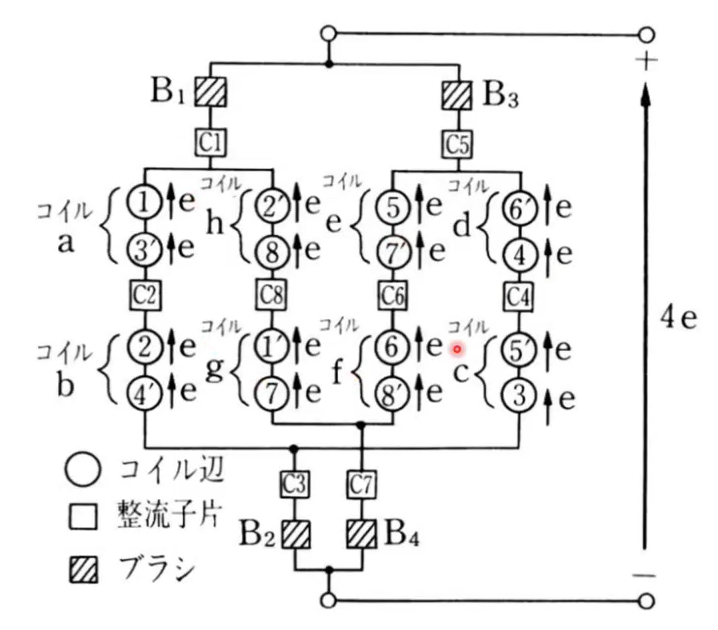

並列回路数は極数と同じ4  
ブラシが多い(4つ)

↓波巻（極数は4）とその回路図
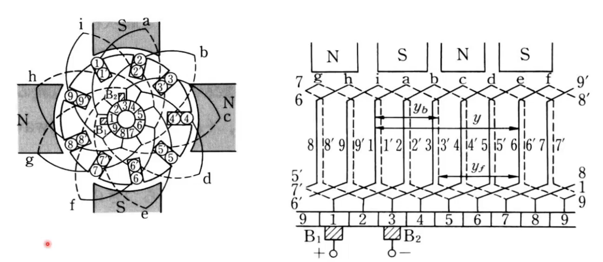

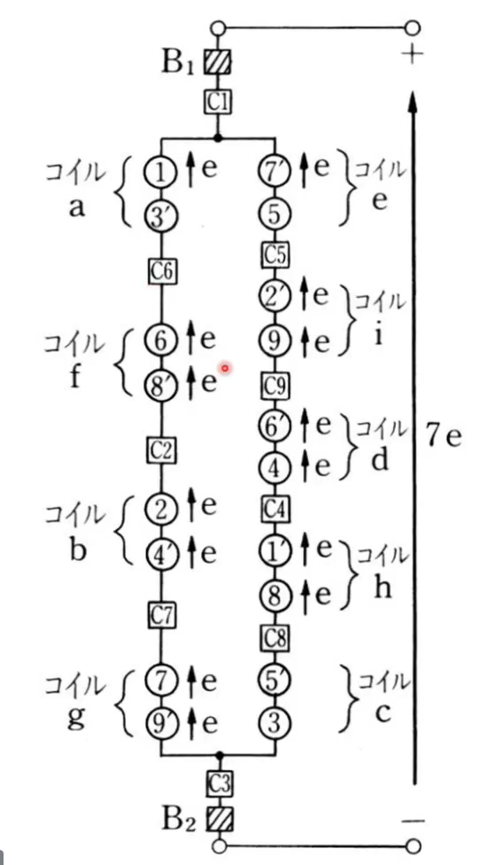

極数は4だが，並列回路数は2．ブラシは2つ  
コイルが直列に繋がっていても磁束と鎖交しない瞬間がある（例えば3'は1枚目の写真の斜め右上のところにある）ので単純に8倍とか10倍ではない．

---

### <u>4．誘導起電力とトルク</u>

#### ・誘導起電力（発電機）

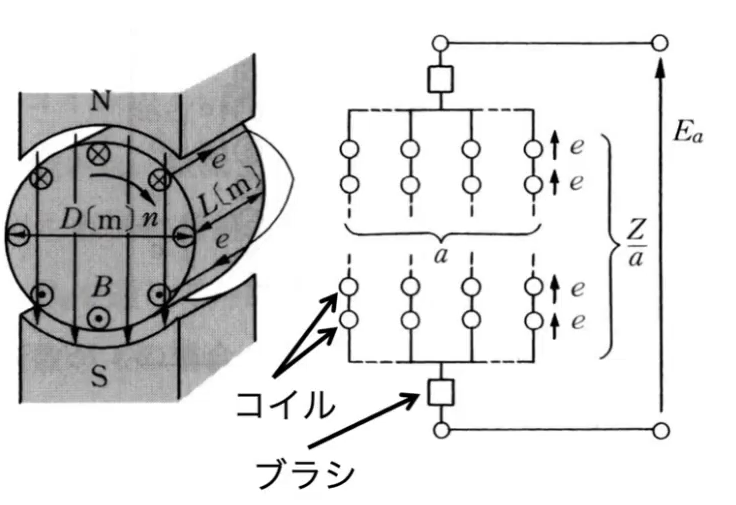

磁束密度 $B\mathrm{[T]}$  
電機子：軸方向長さ $L\mathrm{[m]}$ ，直径 $D\mathrm{[m]}$ ，回転数 $n\mathrm{[rps]}$ (1秒に$n$回転)

導体の周辺速度(コイルの移動速度)を $v\mathrm{[m/s]}$ とすると

$$
e = vBL　\mathrm{[V]}\tag{4.1}
$$

回転数と周辺速度の関係は

$$
v = \pi Dn　\mathrm{[m/s]}
$$

よって

$$
e = \pi DnBL　\mathrm{[V]}\tag{4.2}
$$

ここで，極数を $p$ ，一極あたりの磁束を $\Phi$ とすると電機子周辺の全磁束は

$$
p\Phi = \pi DBL\\
\therefore
B = \frac{p\Phi}{\pi DL}
$$

したがって式(4.2)よりコイル一つあたりの誘導起電力は

$$
e = p\Phi n　\mathrm{[V]}\tag{4.3}
$$

---

これを踏まえて，コイル数を $m$ ，1個のコイルの巻き数を $N$ とすると全導体数 $Z$ は

$$
Z = 2mN
$$

(2はコイル1巻で行って帰る分)

また並列回路数を $a$ とすると， $Z/a$ の導体が直列に接続されるから，端子間の誘導起電力 $E_a$ は，

$$
E_a = \frac{eZ}{a}
= \frac{Zp\Phi n}{a}　\mathrm{[V]}　\because (4.3)より
$$

ここで，角速度を $\omega\mathrm{[rad/s]}$ とすると， $\omega=2\pi n$ ，すなわち $n=\omega/2\pi$

したがって端子間の誘導起電力 $E_a$ は次のように表される．

$$
E_a = K\Phi\omega　\mathrm{[V]}
\\[6pt]
\left(K = \frac{Zp}{2\pi a}\right)
$$

端子間の誘導起電力 $\propto$ 磁束，回転数

---

#### ・トルク（モーター）

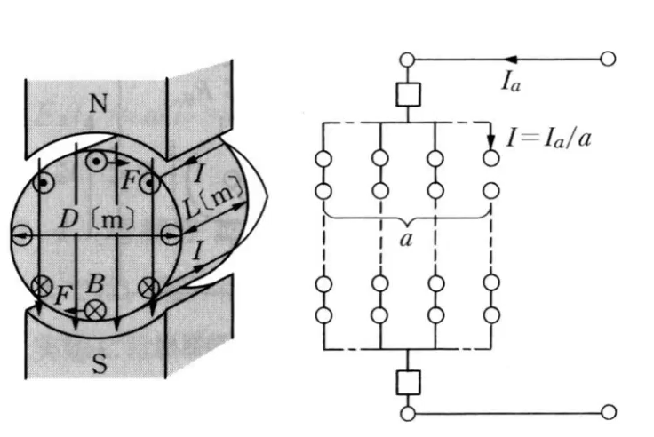

条件はさっきと一緒．  
端子から流入する電流を $I_a$ ，並列回路数を $a$ とすると，導体1本に流れる電流は

$$
I = \frac{I_a}{a}
$$

導体1本に生じる電磁力 $F$ は，

$$
\begin{aligned}
F &= IBL = \frac{BLI_a}{a}　\mathrm{[N]}
\\[6pt]
&=\frac{p\Phi I_a}{\pi Da}　
\because B = \frac{p\Phi}{\pi DL}
\end{aligned}
$$

巻線 $N$ のコイルを $m$ 個設置した電機子全体の導体数は

$$
Z = 2mN
$$

電機子全体に働く全トルク $T$ は，

$$
\begin{aligned}
T_a &= FZ\cdot\frac{D}{2}　(D/2は中心からの距離)
\\[6pt]
&=\frac{p\Phi I_a}{\pi Da}\cdot\frac{ZD}{2}
\\[6pt]
&=\frac{Zp\Phi I_a}{2\pi a}
\end{aligned}
$$

よって

$$
T_a = K\Phi I_a　\mathrm{[Nm]}
\\[6pt]
\left(K=\frac{Zp}{2\pi a}\right)
$$

トルク $\propto$ 磁束，電機子電流

---

#### まとめ
発電機：誘導起電力

$$
E_a = K\Phi\omega　\mathrm{[V]}
$$

電動機：トルク

$$
T_a = K\Phi I_a　\mathrm{[N\cdot m]}
\\[6pt]
\left(KはいずれもK = \frac{Zp}{2\pi a}\right)
$$

回転角速度 $\omega$ で運転しているときは

$$
T_a\omega_m = (K_a\Phi I_a)\omega_m
= (K_a\Phi\omega_m)I_a
= E_a I_a
$$

最左辺が機械エネルギー，最右辺が電気エネルギーを表す，すなわち変換の式．