## 第5回 直流機(続き)，同期機

### <u>整流</u>

直流発電機：電気姉妹船から外部に一定方向の電流を取り出すこと  
直流電動機：電気今汽船の方向を切り替えて，一定方向のトルクを発生させること．

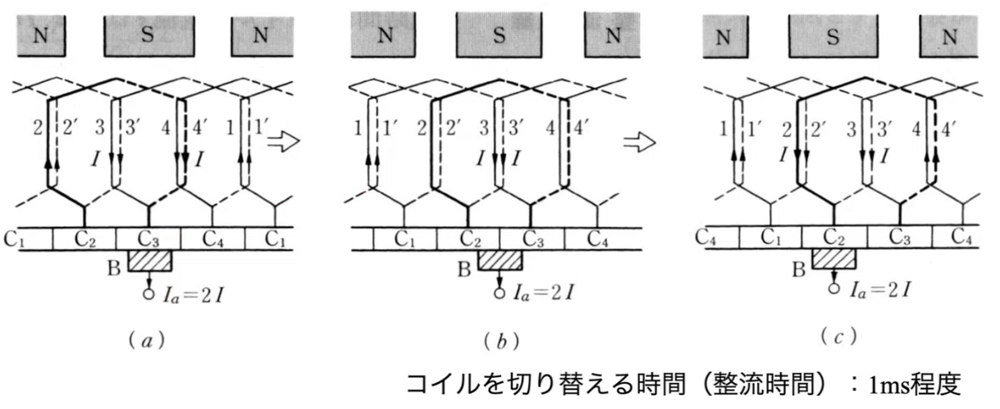  
コイル2つが並列接続→流れる電流は一つのコイルに流れる電流の2倍（ $I_a=2I$ ）

---

#### ・整流方程式

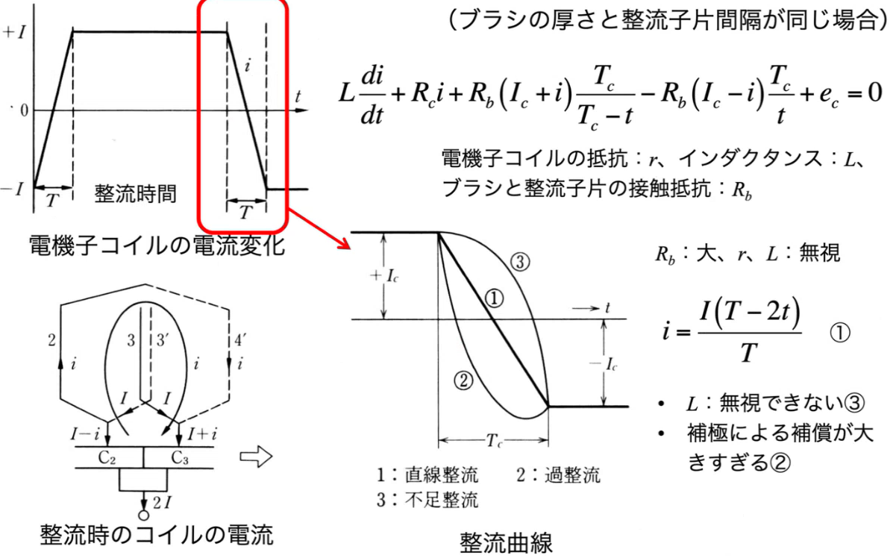  
先生「こういうのがあるというのを見てもらえば良いと思います」

$\frac{T_c}{T_c-i}$ は赤丸で囲った部分の傾きのこと

先生「大事なところは誘導起電力とトルクと電機子反作用」

---

### <u>特性</u>

#### ・他励式発電機

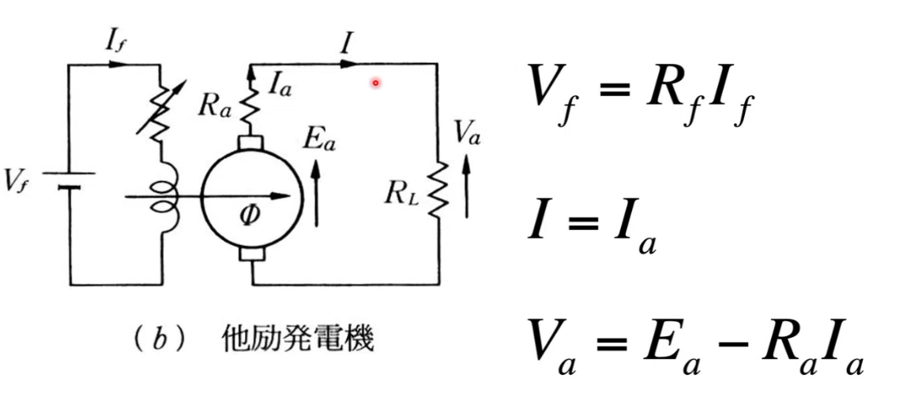

$E_a$ の部分が電機子．左側が電機子の周りに磁界を発生させるための回路．

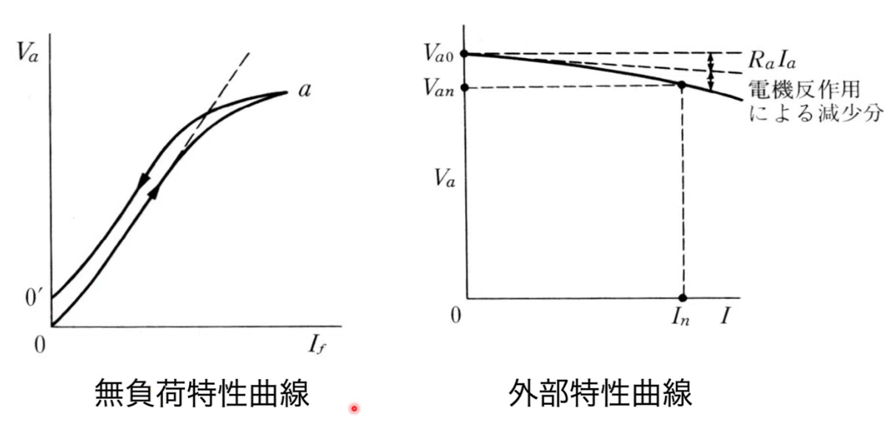

無負荷特性： $R_L$ を繋いでいない(短絡でもない)状態．

　$E_a = K\Phi\omega$ であり， $\Phi$ は $I_f$ に酔って決まるため， $I_f$ が大きくなると $V_a$ も大きくなる．  行きと帰りで形が違うのはヒステリシス特性．

外部特性曲線：抵抗 $R_f$ を繋いで負荷電流 $I_n$ が流れているとき．

---

#### ・直巻発電機

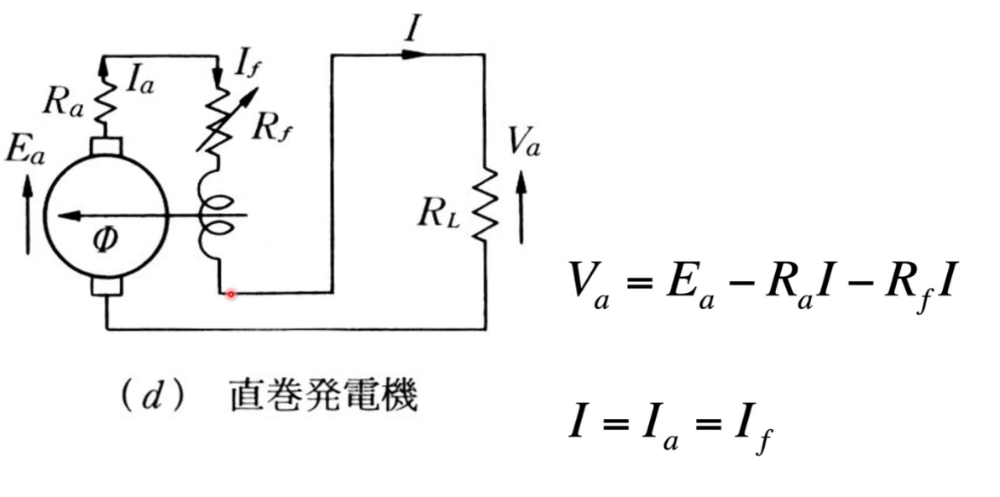

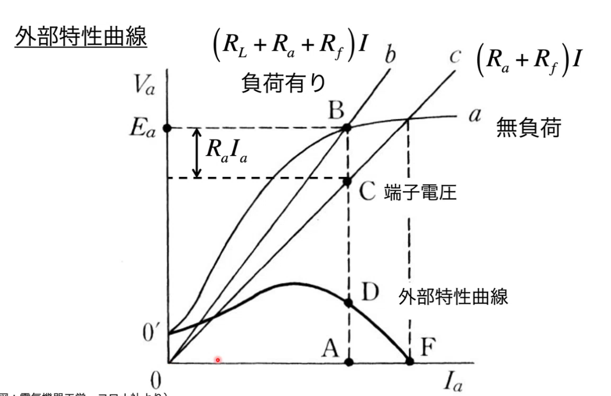

0',D,Fを通る線が外部特性曲線．(無負荷の曲線aから全ての負荷にかかる電圧曲線bを引いた曲線)

重要↓  
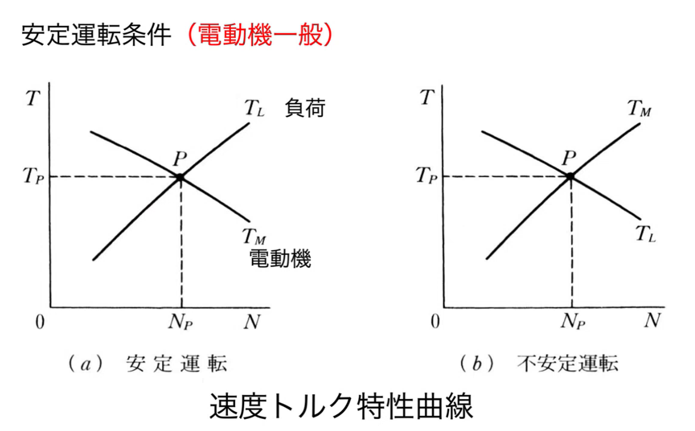

$N$ ：回転数， $T$ ：トルク

右だとなぜ不安定？  
1．何かの拍子に速度が上がった時，モーターのトルク大，負荷側のトルク小  
2．負荷を回転させるトルクが，負荷の回転に必要なトルクよりも大きくなる  
3．過剰なトルクによりさらに速度UP．．．1に戻る．を繰り返す．  
逆に何かの拍子に速度が下がった時は，遅くなり続ける．

左だと，自動的に釣り合っている点Pの位置に戻るようになる．

---

#### ・電動機

先生「この辺はあんまいいですかね…先ほどの発電機と同じような感じですね．はい，この辺ははいいとしましょう．」だけ言われて終わった．

他励電動機  
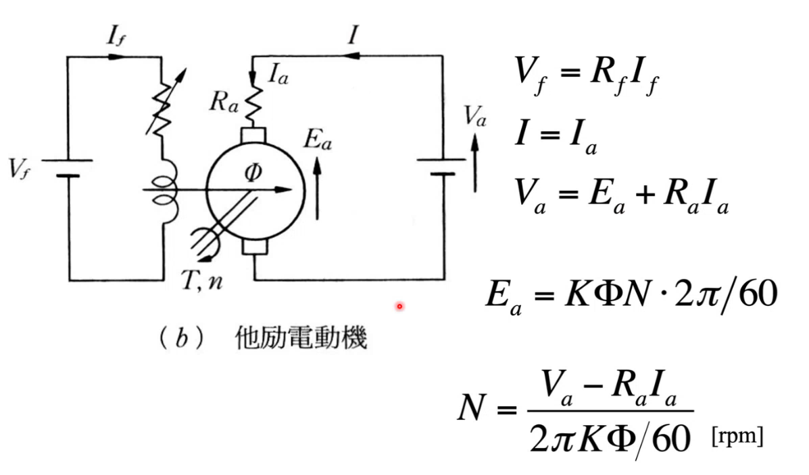

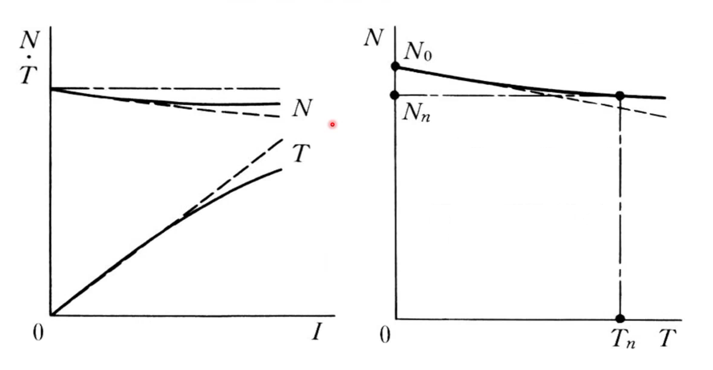

直巻電動機  
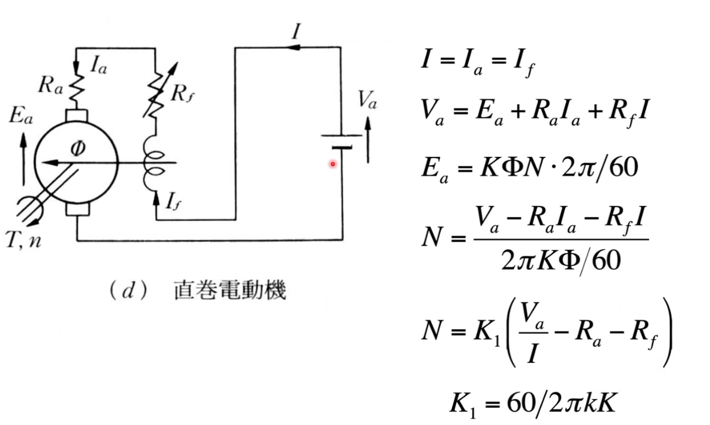

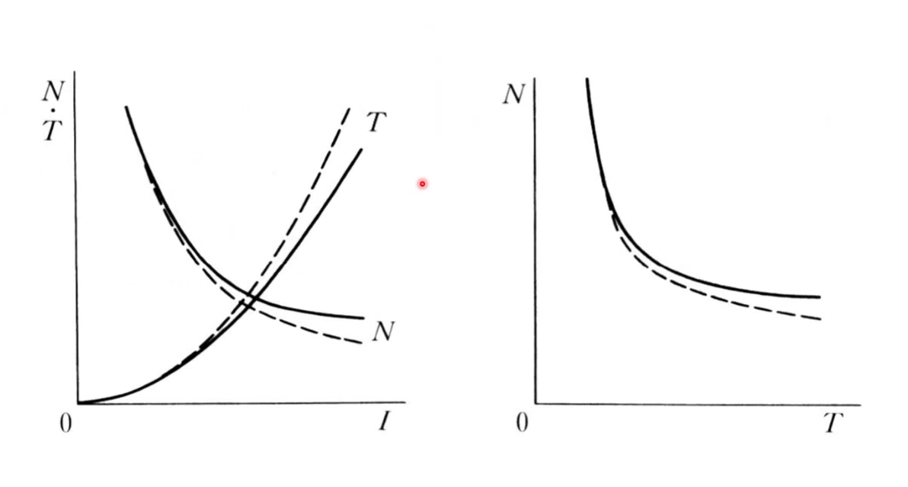

---

ここから同期機について．